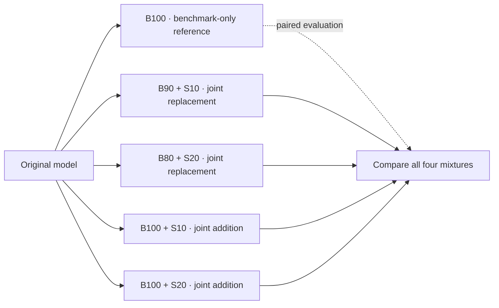

<div align="center">

# Synthetic Joint Training

**How much does synthetic data help when mixed with benchmark training?**

A reproducible experiment toolkit for joint LoRA training, paired evaluation, and reusable checkpoints.

[](pyproject.toml)
[](pyproject.toml)
[](shells/setup_vllm.sh)
[](#seeds-and-ranks)

[Quick Start](#quick-start) · [Experiment Design](#experiment-design) · [Configuration](#configuration-and-synthetic-input) · [Hugging Face](#hugging-face-storage-and-incremental-upload) · [Results](#evaluation-and-results)

</div>

---

Measure whether your synthetic dataset can **replace benchmark examples** or **improve training when added to them**. All four mixtures start independently from the original model and evaluate on the same heldout questions.

| Compare | Control | Inspect | Reuse |
|---|---|---|---|
| Replacement and addition | Frozen data, paired seeds, two ranks | Direct + CoT, extraction and format errors | Shared HF repositories, selective downloads |

The protocol is **joint SFT from the original model**. Benchmark and synthetic examples are shuffled together in one training run. A separate B100 benchmark-only LoRA provides the evaluation reference; joint runs never initialize from it.

## Quick Start

### 1. Install the runtime

Use Linux, Python 3.11 or 3.12, and a CUDA GPU with enough memory for the selected model.

```bash
git clone https://github.com/leobumjin/synthetic-joint-training.git
cd synthetic-joint-training
bash shells/setup_vllm.sh
export DATA_PYTHON="$PWD/.venv/bin/python"
```

### 2. Prepare your data

Provide a JSONL dataset with `prompt`/`response` or chat `messages`. Replace the path below with your own file. The default benchmark is GSM8K.

```bash
bash shells/prepare_dataset.sh \
  --synthetic custom=/absolute/path/to/synthetic.jsonl
```

For a training pool of 1,000 benchmark examples, supply at least **200 unique synthetic examples**. [Input formats and selection arrays →](#configuration-and-synthetic-input)

### 3. Inspect the plan

```bash
bash shells/run_base_lora.sh --dry-run
bash shells/run.sh --synthetic custom --mode all --dry-run
```

| Default scope | Base training | Synthetic training | Evaluation |
|---|---|---|---|
| One model, one benchmark, one synthetic dataset | 6 jobs | 24 jobs | Direct + CoT |

The default grid uses ranks **16/32**, training seeds **0/1/2**, and a frozen custom split capped at **1,000 train / 3,000 test** examples. Dry runs make no network or GPU requests; source data must already be prepared.

### 4. Train and compare

```bash
bash shells/run_base_lora.sh --stage all --resume
bash shells/run.sh --synthetic custom --mode all --resume
bash shells/print_results.sh
```

Completed training and evaluation artifacts are reused. To use published B100 evaluation references, set `BASE_LORA_REPO=<namespace>/synthetic-joint-training-base-loras` for `run.sh` and match the published recipe and model revision. [Checkpoint reuse →](#download-only-the-needed-checkpoints)

<details>
<summary><strong>Try the planning workflow without a GPU</strong></summary>

Python's standard library is sufficient for the demo preparation and dry runs:

```bash
python examples/make_demo_data.py
bash shells/prepare_dataset.sh \
  --local-benchmark-root data/demo/normalized \
  --synthetic demo=data/demo/synthetic.jsonl \
  --data-root data/demo-prepared
bash shells/run_base_lora.sh --data-root data/demo-prepared --dry-run
bash shells/run.sh --data-root data/demo-prepared --synthetic demo --dry-run
```

These fixtures validate the workflow, not benchmark performance. [Verification details →](#offline-verification)

</details>

<details>
<summary><strong>Documentation map</strong></summary>

- [Experiment design](#experiment-design)
- [Seeds and ranks](#seeds-and-ranks)
- [Entry points](#entry-points)
- [Installation](#installation)
- [Configuration and synthetic input](#configuration-and-synthetic-input)
- [Benchmark splitting](#benchmark-splitting)
- [Local output layout](#local-output-layout)
- [Base LoRA training](#base-lora-training)
- [Hugging Face storage and incremental upload](#hugging-face-storage-and-incremental-upload)
- [Base execution and progress](#base-execution-and-progress)
- [Joint synthetic training](#joint-synthetic-training)
- [Evaluation and results](#evaluation-and-results)
- [Offline verification](#offline-verification)
- [Development](#development)

</details>

---

## Experiment design



All percentages refer to the selected benchmark training set of size `N`. By default, source splits are pooled and repartitioned into 25% train and 75% test, capped at 1,000 training examples and 3,000 test examples. The complete selected training set is B100.

| Stage | Conditions |
|---|---|
| Benchmark-only LoRAs | B100 |
| Replacement | B90 + S10, B80 + S20 |
| Addition | B100 + S10, B100 + S20 |

The final comparison has five conditions: B100 and four joint mixtures. Results also include the unadapted model. B80/B90 denote training subsets; no separate B80/B90 adapters are trained.

For each model and benchmark, the default grid creates:

- **6 benchmark-only LoRAs:** B100 × 2 ranks × 3 training seeds.
- **24 joint LoRAs per synthetic dataset:** 4 conditions × 2 ranks × 3 seeds.
- **30 trained artifacts for one synthetic dataset.** Additional synthetic datasets share the same six B100 evaluation references.

Benchmark subsets are nested: `B80 ⊂ B90 ⊂ B100`. Synthetic subsets use prefixes of one frozen order. Data selection and training use separate seeds.

Benchmark counts are `floor(N × fraction)`. Replacement uses `N − benchmark_count` synthetic examples so the combined count is exactly `N`, including rounding. Addition uses `floor(N × synthetic_fraction)`. With `N=1,000`, synthetic stages use 100 or 200 examples.

Every mixture starts from the original model with a fresh LoRA, optimizer, and scheduler. B100 adapters are used only for paired evaluation. Within a run, `--resume` restores its own latest training checkpoint, including optimizer state; a run interrupted before its first checkpoint restarts from the beginning.

Defaults are five epochs for both benchmark-only and joint SFT, no packing, and loss only on the final assistant response. Prompt tokens and earlier assistant turns are masked out of the loss. Overlength examples fail explicitly; they are never silently dropped or truncated. Changing the training recipe creates a different run identity.

The per-device micro-batch is 8 with 2 gradient accumulation steps, giving an effective batch of 16 on one GPU. Raising the micro-batch while reducing accumulation preserves the effective batch; it does not by itself increase the amount learned. More epochs increase repeated exposure and optimizer updates. These defaults are a starting recipe, not a guarantee of convergence.

```bash
EPOCHS=5
JOINT_EPOCHS=  # Empty: inherit EPOCHS
BATCH_SIZE=8
GRADIENT_ACCUMULATION=2
```

For example, 240 benchmark examples take approximately 15 optimizer updates per epoch at effective batch 16, or 75 over five epochs. Synthetic percentages describe unique examples; five joint epochs expose each selected benchmark and synthetic example five times. Addition runs contain more examples and therefore more optimizer updates at the same epoch count. Existing B100 checkpoints with the same recipe remain reusable; older sequential synthetic artifacts have separate protocol identities.

This is an **example-count comparison**, not an exact compute comparison. Different sequence lengths produce different token and compute budgets. Each `training.json` records example counts, input and supervised tokens per epoch, optimizer steps, Trainer-observed input tokens, selected example IDs, hashes, and library versions. Trainer-observed tokens can include padding.

## Seeds and ranks

Training seeds default to `0, 1, 2`. Every condition uses the same frozen data subsets; these seeds measure training variation from initialization, shuffling, and other stochastic operations. Compare paired improvements for matching seeds, and report the mean and sample standard deviation. Three seeds are a starting point, not a guarantee of statistical significance. If improvements are small or inconsistent, expand all comparison conditions using a predefined rule instead of selecting favorable seeds.

`DATA_SEED=42` controls data selection. Varying this seed is a separate experiment on subset sensitivity. Question-bootstrap confidence intervals are conditional on the available training seeds and do not replace uncertainty across training runs.

The default rank grid keeps `alpha/rank=2`:

| Rank | Alpha |
|---|---|
| 16 | 32 |
| 32 | 64 |

Benchmark-only and joint adapters use the same rank and alpha. Rank is included in the recipe and run identity; paired comparisons stay within matching ranks, seeds, and reference recipes. The result table displays Rank and Alpha explicitly. Learning rate, epochs, data, seeds, and target modules otherwise remain fixed across ranks.

```bash
# Run both configured ranks.
bash shells/run_base_lora.sh --dry-run
bash shells/run.sh --dry-run

# A single-rank override takes precedence over the configured rank array.
bash shells/run_base_lora.sh --lora-rank 16 --dry-run
bash shells/run.sh --lora-rank 16 --dry-run
```

Use `--lora-ranks 16 32` to override the array. Leave `LORA_ALPHA` unset for automatic `2 × rank` scaling. An explicit `LORA_ALPHA` or `--lora-alpha` applies that value to every selected rank.

The default experiment reports both ranks. Selecting a rank based on performance requires validation data separate from the final test set. The custom split currently creates train/test only; it does not create validation automatically.

## Entry points

**Configure → Prepare → Train B100 references → Train joint mixtures → Evaluate → Share**

| Script | Purpose |
|---|---|
| [setup_vllm.sh](shells/setup_vllm.sh) | Install or check the pinned SFT/vLLM environment. |
| [prepare_dataset.sh](shells/prepare_dataset.sh) | Download source benchmarks, freeze subsets, and validate synthetic pools. |
| [env.sh](shells/env.sh) | Configure models, benchmarks, synthetic datasets, seeds, training, and evaluation. |
| [run_base_lora.sh](shells/run_base_lora.sh) | Train/evaluate base LoRAs, register them, and optionally publish them. |
| [run.sh](shells/run.sh) | Train replacement/addition mixtures from the original model. |
| [hf_push_lora_parmas.sh](shells/hf_push_lora_parmas.sh) | Upload completed adapters without running training or evaluation. |
| [print_results.sh](shells/print_results.sh) | Discover saved results and report seed statistics and paired improvements. |

`_common.sh` is an internal argument-sharing helper. Entry points support `--help`; CLI arguments override configured defaults. Default filesystem paths are relative to the repository, regardless of the invoking directory. The upload script retains the requested `parmas` spelling.

## Installation

Use Linux with Python 3.11 or 3.12 and a working CUDA environment. The pinned runtime includes PyTorch 2.8.0, Transformers 4.57.6, PEFT 0.17.1, and vLLM 0.11.0. SFT uses Transformers Trainer; inference uses vLLM in a separate worker process. Base training runs all configured adapters for a model in one persistent training worker, followed by one persistent inference worker.

Default SFT assumes the model fits on one device. Sharded training for larger models is not implemented. Tensor-parallel inference is supported.

```bash
bash shells/setup_vllm.sh --dry-run
bash shells/setup_vllm.sh
bash shells/setup_vllm.sh --check
```

Set `SJT_VENV` to change the environment location. Set `TRAIN_PYTHON` and `INFERENCE_PYTHON` when using separate existing environments. Planning and result inspection do not import GPU libraries. Official dataset downloads require the data dependencies:

```bash
DATA_PYTHON="$PWD/.venv/bin/python" bash shells/prepare_dataset.sh --help
```

For gated models or FOLIO, obtain access and authenticate with Hugging Face first. Tokens are not stored in configuration or manifests.

## Configuration and synthetic input

Edit the selection arrays in `shells/env.sh`:

```bash
MODELS=(
  "Qwen/Qwen3-4B-Instruct-2507"
)
BENCHMARKS=(
  gsm8k
  # mmlu
  # folio
)
SYNTHETIC=(
  "edit=/path/to/edit.jsonl"
  "rebuild=/path/to/rebuild.jsonl"
)
TRAIN_SEEDS=(0 1 2)
PROMPT_STYLES=(Direct CoT)
LORA_RANKS=(16 32)
```

Each synthetic entry is an independent dataset; entries are not automatically mixed. Specify `name=/path/to/train.jsonl` or a JSONL path whose filename stem becomes the name. Names must be unique. The default array is empty so users can supply their own files. Benchmark-only preparation and base training work without synthetic input. If no synthetic name is selected at execution time, `run.sh` uses all prepared named datasets.

Synthetic JSONL accepts either `id` plus `messages`, or `prompt`/`response`:

```json
{"id":"s-001","messages":[{"role":"user","content":"Reverse: abc"},{"role":"assistant","content":"cba"}]}
{"id":"s-002","prompt":"What follows A, B?","response":"C"}
```

Missing IDs are derived from message content. Duplicate IDs/content, empty input, and invalid role order are rejected. Optional `group_id` values are retained. Synthetic data is used only for training here; synthetic train/evaluation splitting is not performed automatically. If you split it externally, keep related groups together.

Each pool needs at least `ceil(N × .20)` unique examples. Insufficient pools are not automatically repeated.

```bash
# Prepare the configured selection.
DATA_PYTHON="$PWD/.venv/bin/python" bash shells/prepare_dataset.sh

# Override the selection from the CLI.
DATA_PYTHON="$PWD/.venv/bin/python" bash shells/prepare_dataset.sh \
  --benchmarks gsm8k mmlu folio \
  --synthetic edit=/path/to/edit.jsonl rebuild=/path/to/rebuild.jsonl

# Run one prepared synthetic dataset.
bash shells/run.sh --synthetic edit --mode all
```

## Benchmark splitting

Source revisions are pinned in `benchmarks.py`. The default custom policy pools GSM8K train/test, MMLU auxiliary_train/validation/test, or FOLIO v2 train/validation, deduplicates inputs, and creates a new split using the data seed. Related groups stay on one side. Independent caps are then applied to each split; remaining examples are unused. Whole-group assignment can produce fewer examples than the requested targets.

```bash
SPLIT_POLICY=custom
TRAIN_FRACTION=0.25
MAX_TRAIN=1000
MAX_TEST=3000
DATA_SEED=42
```

These settings are also available as `--split-policy`, `--train-fraction`, `--max-train`, and `--max-test`. Selected IDs, source splits, counts, and hashes are recorded in manifests. **Custom-split scores are not official benchmark-split scores.**

Use `--split-policy official` only to reproduce the earlier official-split protocol. `MMLU_TRAIN_SAMPLES` controls MMLU training selection in that mode and has no effect on custom splitting.

Exact synthetic prompt overlaps with benchmark heldout prompts are rejected. This is an exact-match check, not a guarantee against semantic overlap or external contamination.

Preparing synthetic datasets later with the same benchmark settings preserves the benchmark identity. Named synthetic pools remain available when another pool is added. The legacy single-pool `--synthetic-file` option is also supported.

## Local output layout

Base artifacts and joint LoRAs use separate roots. Both directories are excluded from Git.

```text
outputs_base_lora/                 # Reusable benchmark checkpoints and reference scores
├── plans/
├── runs/<run-id>/
│   ├── job.json
│   ├── training.json
│   ├── adapter/
│   ├── checkpoints/              # Incomplete runs only; removed after verified completion
│   └── evaluations/
└── hf_uploads.json                # Written by the upload-only script

outputs/                           # Joint LoRAs and optional repeat controls
├── plans/
├── runs/<run-id>/
│   ├── job.json
│   ├── training.json
│   ├── adapter/
│   ├── checkpoints/              # Incomplete runs only; removed after verified completion
│   └── evaluations/
└── hf_uploads.json                # Written by the upload-only script
```

The base root also holds unadapted-model evaluations and B100 reference evaluations requested by synthetic runs. Evaluation-only runs need not have training files or adapters in their local run folders.

Override paths through `BASE_OUTPUT_ROOT` / `OUTPUT_ROOT`, or `--base-output-root` / `--output-root`. `run_base_lora.sh` writes to the base root; `run.sh` writes joint runs to the synthetic root and references to the base root. Run identities do not depend on these paths.

`print_results.sh` searches both roots and pairs matching references across them. The uploader also searches both roots and registered local adapter paths. Identical copied reports are counted once. Existing mixed-root results remain readable and uploadable; files are not automatically moved. To resume base training in an older location, set `BASE_OUTPUT_ROOT` to that location.

## Storage cleanup and server migration

Run the normal base command again with the same model, data, and recipe settings:

```bash
bash shells/run_base_lora.sh
```

Completed LoRAs are verified and reused without retraining. Their intermediate `checkpoints/` directories, including optimizer state, are removed after the final adapter hash is verified. Newly completed runs perform the same cleanup automatically. Interrupted runs retain recovery checkpoints; use `--resume` to continue them. Completed evaluation reports are reused.

Final `adapter/` files (including tokenizer files), `training.json`, `job.json`, and evaluation reports/predictions remain in the existing output directories. No export step is required. For migration, copy these output directories and `configs/base_lora_registry.json` into the same relative repository layout on the destination server. The default registry uses relative paths. Copy matching prepared `data/` separately if further training/evaluation is needed. Phase requests and locks are small runtime files and need not be transferred.

## Base LoRA training

Select models, benchmarks, ranks, and seeds in `env.sh`. The base recipe is the compatibility contract for subsequent synthetic runs.

```bash
bash shells/run_base_lora.sh --dry-run
bash shells/run_base_lora.sh --stage train
bash shells/run_base_lora.sh --stage eval
bash shells/run_base_lora.sh --stage all --resume
```

Actual execution resolves model revisions to immutable commit SHAs. Reuse the recorded SHA through `MODEL_REVISION` or `--revision` to select the same checkpoints later. Run models separately when supplying different fixed SHAs. Dry runs are network-free; mutable model revisions and resulting run IDs are finalized only during actual execution.

Completed base adapters are registered in `configs/base_lora_registry.json`. The initial registry is empty; missing base LoRAs are never silently trained during synthetic execution.

Optional publication is explicit:

```bash
HF_NAMESPACE=my-account bash shells/run_base_lora.sh \
  --stage train --resume --push-to-hub
```

Completed training is reused, so the same command can publish already trained base adapters.

## Hugging Face storage and incremental upload

Upload completed local adapters independently of training:

```bash
# Validate local files and show destinations without network requests.
HF_NAMESPACE=my-account bash shells/hf_push_lora_parmas.sh --dry-run

# Publish base adapters.
HF_NAMESPACE=my-account DATA_PYTHON="$PWD/.venv/bin/python" \
  bash shells/hf_push_lora_parmas.sh

# Include joint LoRAs.
HF_NAMESPACE=my-account DATA_PYTHON="$PWD/.venv/bin/python" \
  bash shells/hf_push_lora_parmas.sh --kind all
```

Set `HF_NAMESPACE` to a username or organization. Filter with `--kind synthetic`, `--models`, `--benchmarks`, `--seeds`, or `--job-ids`. By default, the uploader discovers all completed local base adapters regardless of current training selections. Incomplete runs are excluded and completed files are verified. `--private` makes newly created repositories private; it does not change existing repository visibility.

All base adapters share one model repository:

```text
my-account/synthetic-joint-training-base-loras/
├── registry.json
└── models/
    └── Qwen/Qwen3-4B-Instruct-2507/
        └── gsm8k/
            └── seed-0/
                ├── b80/<full-run-hash>/
                │   ├── training.json
                │   └── adapter/
                │       ├── adapter_config.json
                │       ├── adapter_model.safetensors
                │       └── tokenizer files
                ├── b90/<full-run-hash>/
                └── b100/<full-run-hash>/
```

Use `HF_REPO` or `--hf-repo` to change the base repository name. Model paths include the original namespace to distinguish models with the same short name. Rank and other recipe settings are distinguished by the full run hash.

Joint LoRAs use the separate shared repository `synthetic-joint-training-synthetic-loras`. Set `HF_SYNTHETIC_REPO` or `--hf-synthetic-repo` to organize repositories by synthetic dataset. Their checkpoint paths include conditions such as `b80-synth20`.

Only the selected checkpoint folder is uploaded. Unchanged registered runs are skipped. Different content under an existing run ID fails instead of overwriting the registered artifact. Different data or recipes create new run-hash paths. Other checkpoint folders are preserved.

The shared `registry.json` records each checkpoint's `repo_id`, `checkpoint_path`, adapter `subfolder`, immutable weight `revision`, file hashes, and recipe. Registry merges preserve existing entries and retry concurrent update conflicts. The weight revision remains pinned even after later uploads. If an upload is interrupted between writing weights and updating the registry, rerun it to finish registration.

Uploads contain adapter/tokenizer files and `training.json`, including selected example IDs and provenance. Full base-model weights, optimizer checkpoints, original datasets, and evaluation completions are excluded. The upload-only script records base uploads in `outputs_base_lora/hf_uploads.json` and synthetic uploads in `outputs/hf_uploads.json`. Base uploads also update the local base registry. Local base adapters live at `outputs_base_lora/runs/<run-id>/adapter/`; joint adapters live at `outputs/runs/<run-id>/adapter/`.

### Download only the needed checkpoints

```bash
BASE_LORA_REPO=my-account/synthetic-joint-training-base-loras \
  bash shells/run.sh --mode addition
```

The loader first fetches the small registry, then downloads only `adapter/*` and `training.json` for each required checkpoint at its pinned commit. Only B100 references needed for evaluation are downloaded. Joint training with `--stage train` requires no base-adapter registry or download; it loads the original model. Hugging Face caches are reused; original model weights are downloaded separately as needed.

A local registry can be selected with `--registry`. Pin a remote registry snapshot with `BASE_LORA_REVISION=<commit-sha>` or `--base-lora-revision`. Required registry entries are checked before training starts. Dry runs do not contact Hugging Face.

Transfers use the [Hugging Face Hub upload API](https://huggingface.co/docs/huggingface_hub/en/guides/upload).

## Base execution and progress

Both baseline and joint workflows use two phases per model (and selected synthetic dataset):

1. **Train all selected LoRAs.** Load the frozen backbone and tokenizer once. Attach one fresh LoRA, create a fresh Trainer/optimizer, train and save it, then unload the adapter **without merging** before moving to the next condition. Original backbone weights remain unchanged. Tokenized examples are cached across nested fractions, ranks, and seeds. Completed adapters are verified and counted as cached work without loading the model.
2. **Evaluate all selected LoRAs.** Exit the training worker to release its GPU resources, then load one vLLM backbone. Evaluate the unadapted reference and each saved adapter. The inference engine keeps at most one GPU/CPU LoRA slot and uses a unique adapter ID for each checkpoint. Prompts are cached across adapters. Original-model references are separate from the LoRA progress total.

The default B200-oriented micro-batch is **8**, with accumulation **2** to preserve effective batch **16** on one GPU. Benchmark-only and joint runs both use **5 epochs** by default. Set `BATCH_SIZE`, `GRADIENT_ACCUMULATION`, or their CLI equivalents to change this recipe. Larger micro-batches improve parallel work per forward/backward pass but do not guarantee a particular throughput gain.

Progress has two levels. This is an illustrative layout, not recorded benchmark output:

```text
Base training | Qwen3-4B-Instruct-2507 | gsm8k | B100 | rank=16 alpha=32 | seed=0   0/6 LoRA
  Steps | gsm8k B100 r16 s0                              0/<optimizer updates>

Base evaluation | Qwen3-4B-Instruct-2507 | gsm8k | B100 | rank=16 alpha=32 | seed=0  0/6 LoRA
  Inference batches | gsm8k B100 r16 s0 Direct            0/<inference batches>
  Inference batches | gsm8k B100 r16 s0 CoT               0/<inference batches>
```

The training step bar initially shows examples, epochs, micro-batch, and effective batch, then displays logged loss. The evaluation outer bar displays Direct/CoT accuracy for the latest adapter. Batch bars show processed examples and running accuracy. vLLM's additional per-request bar is disabled.

```bash
EVAL_BATCH_SIZE=64
bash shells/run_base_lora.sh --stage all --resume

# Override the inference chunk size explicitly.
bash shells/run_base_lora.sh --stage eval --eval-batch-size 64
```

Inference batches are explicit chunks of evaluation prompts; vLLM still schedules sequences internally. `EVAL_BATCH_SIZE` is independent of training micro-batch and is recorded in evaluation settings. Cached complete reports are reused without loading the inference engine when all requested results already exist.

Base-stage execution now uses training protocol `sequential-direct-json-v2`, which fixes per-adapter seed reset immediately before initialization. New training runs do not silently reuse artifacts from the earlier protocol. Evaluation records `shared-lora-v1` and the inference batch size so older engine configurations remain distinguishable.

Joint runs use the same persistent model-scoped phases, with an outer total of 24 LoRAs for the default grid. Each fresh adapter is unloaded without merging. B100 reference evaluations run outside the joint LoRA progress total. Joint jobs use protocol `joint-direct-json-v1`, keeping legacy sequential results separate.

## Joint synthetic training

```bash
bash shells/run.sh --mode all --dry-run
bash shells/run.sh --mode replacement --resume
bash shells/run.sh --mode addition --resume
```

The B100 evaluation reference must match the model revision, benchmark identity, seed, rank, and reference recipe. All mixtures initialize from the original model. To explicitly change only joint epochs or learning rate:

```bash
bash shells/run.sh --mode all \
  --joint-epochs 5 --joint-learning-rate 2e-5
```

`--epochs` and `--learning-rate` define the common recipe and B100 reference selection. Joint overrides default to those values; record explicit overrides when comparing results. Training and evaluation can run separately with `--stage train|eval|all`. Train-only joint runs require no B100 checkpoint. The default `all` evaluates joint adapters, matching B100 references, and the unadapted model.

An optional benchmark-repeat control helps separate synthetic-data effects from extra training:

```bash
bash shells/run.sh --mode addition --control benchmark-repeat --resume
```

Each rank/seed pair gets two additional controls starting from the original model. Benchmark examples are repeated to the nearest whole-example input-token budget of the entire matching joint mixture. This is not exact token or compute matching because examples are not truncated. Differences are recorded under `budget_match` in `training.json`. These controls are additional to the default 24 synthetic training runs.

## Evaluation and results

```bash
bash shells/print_results.sh
bash shells/print_results.sh --models Qwen/Qwen3-4B-Instruct-2507 \
  --benchmarks gsm8k --bootstrap-samples 1000
```

Results are discovered from saved manifests in both `outputs_base_lora/` and `outputs/`, without requiring the original data paths. Different model revisions, benchmark identities, evaluation settings, or runtime/parser versions stay in separate cohorts. Different training recipes and synthetic datasets stay in separate rows.

Reports include:

- Accuracy, extraction failure, requested-format violation, and generation-length-limit rates.
- Rank, alpha, available seed counts, mean accuracy, and sample standard deviation.
- Paired improvements over matching B100 using the same seed and evaluation questions. Legacy sequential rows retain their parent deltas and remain separate from joint rows.
- Optional paired question-bootstrap 95% confidence intervals, conditional on available training seeds.
- Raw prompts, completions, completion token IDs, and per-question scoring in adjacent JSONL files.

Benchmark SFT trains on JSON final answers only. Evaluation runs both Direct and CoT by default; select one with `--prompt-styles Direct` or `--prompt-styles CoT`. CoT asks for reasoning followed by a final-line JSON answer. It is a prompting condition, not evidence that reasoning was learned during SFT. Masking prompt loss does not guarantee that short-answer training leaves CoT output behavior unchanged.

Decoding defaults to temperature 0, native thinking disabled, 256 output tokens for Direct, and 2,048 for CoT. The fixed final checkpoint is evaluated; the custom test set is shared across all conditions and must not be repeatedly used for tuning. Custom preparation does not create validation automatically. Official-split reproduction can use MMLU validation.

### Answer extraction

Both styles use the same gold-independent parser, `explicit-answer-v3`. It accepts answer JSON, explicit answer markers, boxed answers, and standalone answers. It never guesses from an arbitrary last number. Conflicting answers, invalid explicit answers, duplicate JSON keys, and unfinished thinking blocks fail extraction.

GSM8K numeric JSON values can be extracted but violate the requested string-valued JSON schema. Invalid thousands separators are rejected, and long integers are normalized without Decimal-context rounding.

Extraction success is separate from requested-format compliance. Compliance is checked against the original completion before removing reasoning tags: Direct requires only the answer JSON, while CoT requires a standalone JSON object on its final line. Per-question `extraction_source` and `extraction_error`, plus report-level error counts, support audits. Different parser versions are not silently combined or used to overwrite prior results.

## Offline verification

```bash
python examples/make_demo_data.py
bash shells/prepare_dataset.sh \
  --local-benchmark-root data/demo/normalized \
  --synthetic-file data/demo/synthetic.jsonl --data-root data/demo-prepared
bash shells/run_base_lora.sh --data-root data/demo-prepared --dry-run
bash shells/run.sh --data-root data/demo-prepared --mode all --dry-run
python -m pytest -q
```

Demo data validates execution paths only; its scores are not research results. Prepare real source data before research runs. Offline tests and dry runs do not validate GPU training, inference, or live Hub uploads; those require a working runtime and separate execution.

## Development

See [AGENT.md](AGENT.md) for repository conventions, experiment invariants, and validation commands. Repository documentation, code comments, messages, and examples are written in English.

Benchmark normalization and conservative answer extraction originated in `iclr2027-retraction-rebuttal` and were separated into standalone modules. This project has no runtime dependency on that repository's Python paths or data files.

Implementation references:

- [PEFT adapter configuration](https://huggingface.co/docs/peft/guides/peft_model_config)
- [Transformers Trainer](https://huggingface.co/docs/transformers/main_classes/trainer)
- [vLLM LoRA inference](https://docs.vllm.ai/en/latest/features/lora/)

---

[Back to top ↑](#synthetic-joint-training)
